<h3 align="center"> Hi👋 I'm Vishalini P G, an aspiring Software Developer from India</h3>

  
  
  

<h3 align="left">🐍 Contributions</h3>

<picture>
  <source media="(prefers-color-scheme: dark)" srcset="https://raw.githubusercontent.com/vishalinipg/vishalinipg/output/github-snake-dark.svg" />
  <source media="(prefers-color-scheme: light)" srcset="https://raw.githubusercontent.com/vishalinipg/vishalinipg/output/github-snake.svg" />
  
</picture>

<h3 align="left">🛡️ Badges</h3>

  <a href="https://www.credly.com/badges/2d1397a3-6eed-4153-950e-c9258d983dec" target="_blank">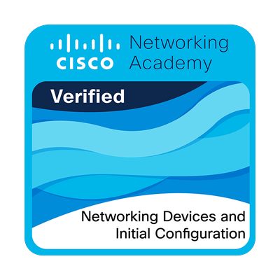</a>  
  <a href="https://www.credly.com/badges/c7da76ae-6194-4729-b77c-6f7764269fe1" target="_blank">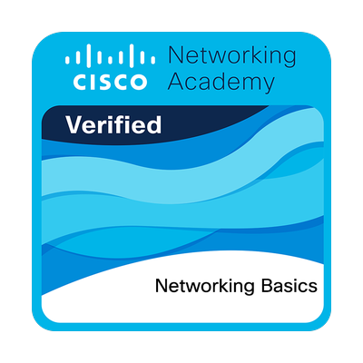</a>
  
  <a href="https://www.credly.com/badges/6ec56fb5-3f33-4715-9849-c76114793dec" target="_blank">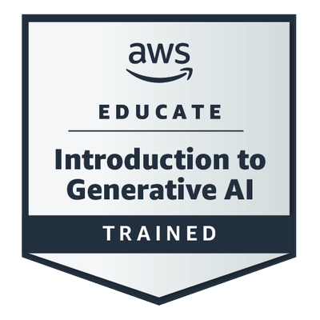</a>
  <a href="https://www.credly.com/badges/3a965033-27ee-4275-a721-8ef8699d237f" target="_blank">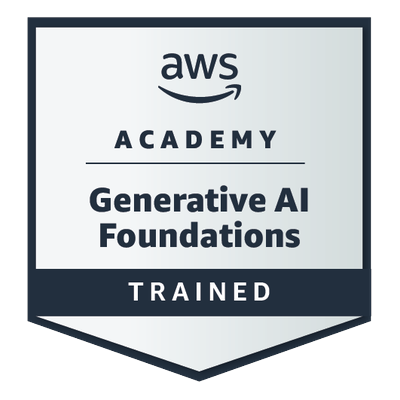</a>
  <a href="https://www.credly.com/badges/8ad73692-19c9-452f-8439-3575f21b91f2" target="_blank">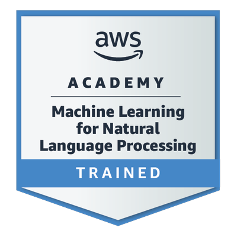</a>
  
  <a href="https://www.credly.com/badges/7375a5a8-df24-4df3-af8f-8b8c20431193" target="_blank">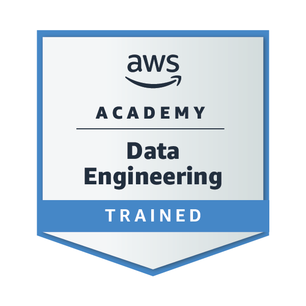</a>
  
  
  <a href="https://www.credly.com/badges/5d52f71f-11c6-4e05-a8cc-4eaa3faa45b0" target="_blank">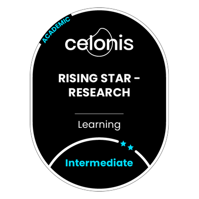</a>
  <a href="https://www.credly.com/badges/7a286e86-a451-47b5-8f7d-d1a7661ae642" target="_blank">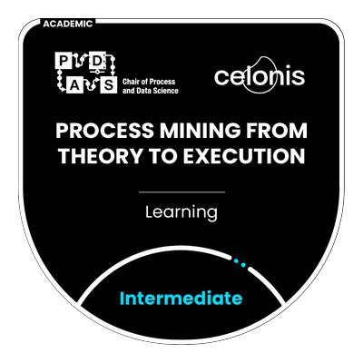</a>
  <a href="https://www.credly.com/badges/97bc6bbc-8e52-4cc6-95dc-a7ec6abca9a9" target="_blank">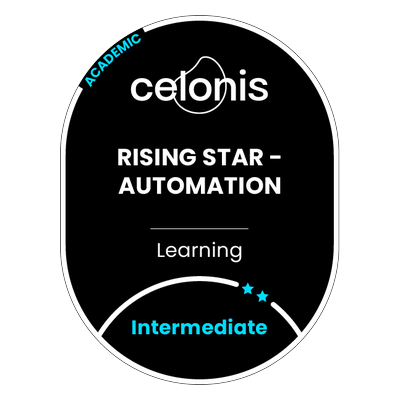</a>
  <a href="https://www.credly.com/badges/47c142b4-18fc-4911-8031-2088fe961d1c" target="_blank">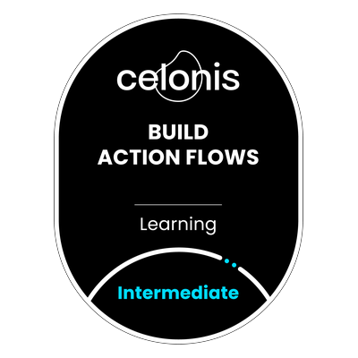</a>
  <a href="https://www.credly.com/badges/e902cd80-d349-48b4-ad63-5bf801e5bed0" target="_blank">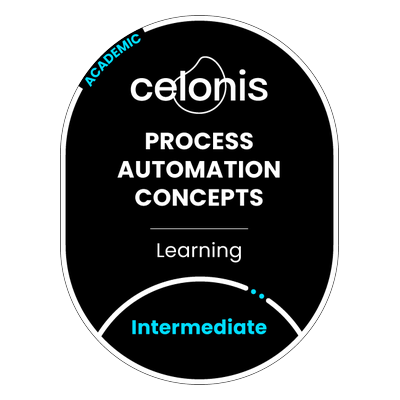</a>
  <a href="https://www.credly.com/badges/b02561ae-1ab6-47ca-a17d-2bf1d5ae7a94" target="_blank">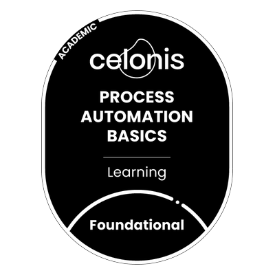</a>
  <a href="https://www.credly.com/badges/8ddbf398-3cd5-42d1-a582-83ed44165ac8" target="_blank">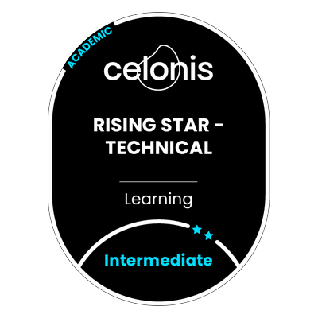</a>
  <a href="https://www.credly.com/badges/b1e1f14b-9f01-40ce-8eee-b25bbde5f010" target="_blank">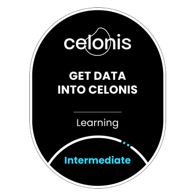</a> 
  <a href="https://www.credly.com/badges/60445c32-8fb5-4c31-8135-8a74592e6384" target="_blank">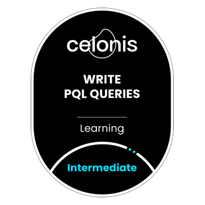</a>
  
  <a href="https://www.credly.com/badges/8fa3e0f7-5565-49bc-9aef-fea44de9d49c" target="_blank">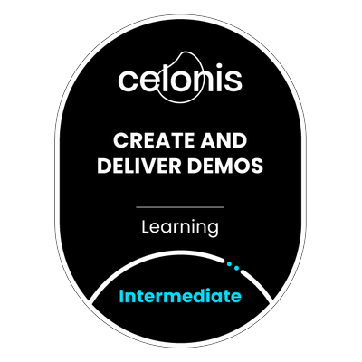</a>
  <a href="https://www.credly.com/badges/a543ea0e-4f7a-4dea-94a9-ff22bde0f916" target="_blank">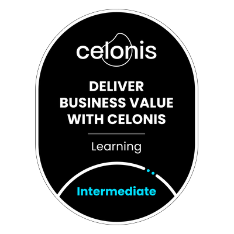</a>
  <a href="https://www.credly.com/badges/183d5c72-74c9-4785-b545-abe5a4b1578a" target="_blank">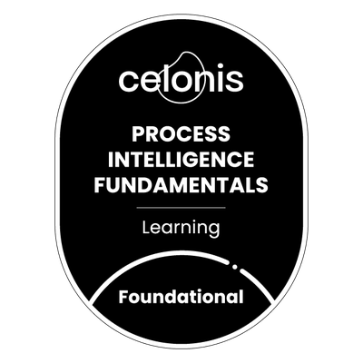</a>
  <a href="https://www.credly.com/badges/98b1a581-5307-4357-9976-255c8630e0b2" target="_blank">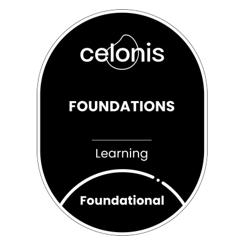</a>
  <a href="https://openbadgefactory.com/v1/assertion/8fec5536cedce8585b08b17f2c1f3da552f3ce69" target="_blank">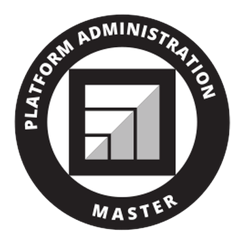</a>
  <a href="https://openbadgefactory.com/v1/assertion/72509626211963fdee9bae68c0a2145442e09517" target="_blank">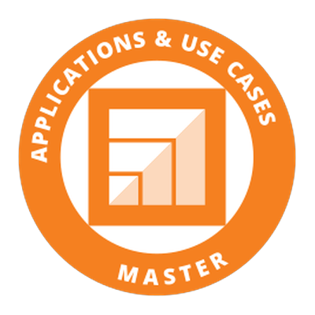</a>
  <a href="https://openbadgefactory.com/v1/assertion/26caccba47f18c1e1960cfbe5eeff221fbfa6e47" target="_blank">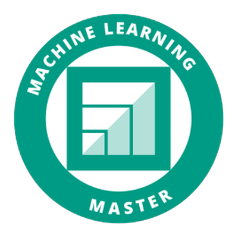</a>
  <a href="https://openbadgefactory.com/v1/assertion/69a5dbde5ebf047432055a0a6467fd74a504ce86" target="_blank">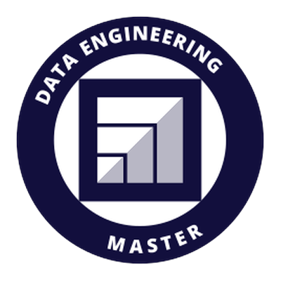</a>
  
  
  
  

