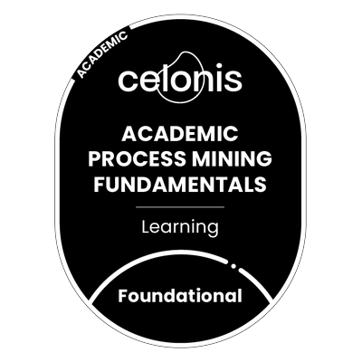

<h3 align="center"> Hi👋 I'm Vishalini P G, an aspiring Software Developer from India</h3>

  
  
  

<picture>
  <source media="(prefers-color-scheme: dark)" srcset="https://raw.githubusercontent.com/vishalinipg/vishalinipg/output/github-snake-dark.svg" />
  <source media="(prefers-color-scheme: light)" srcset="https://raw.githubusercontent.com/vishalinipg/vishalinipg/output/github-snake.svg" />
  
</picture>

<h3 align="left">🛡️ Badges</h3>

    
  
  
  
  
  
  
  
  
  
  
  
  
  
  
  
  
  
  
  
  
  
  
  
  
  
  
  
  
  
  

